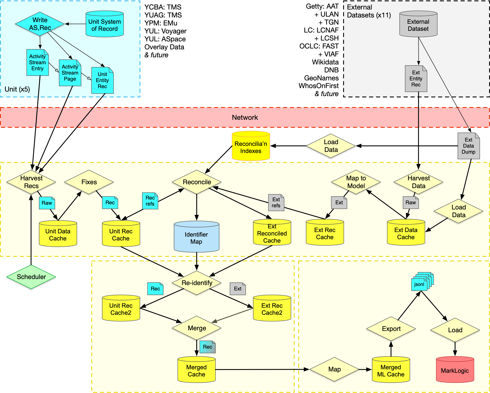

# Data Transformation Pipeline Code

## Installation

See [docs/install.md](docs/install.md): system packages, `pip install -e .`,
`lux initialize`, `lux testinstall`, downloading and loading data.
[docs/rebuild.md](docs/rebuild.md) describes a rebuild step by step and
[docs/codebase.md](docs/codebase.md) is a tour of the code.

## Running

Everything runs through the `lux` command (`lux help` lists them all):

```
lux download --source all --type records --max-workers 10   # fetch the sources' dump files
lux load --source wikidata --max-workers 24                 # load a dump into its datacache
lux reconcile --source all --max-workers 24                 # reconcile, then identify, metatypes, write-refs
lux merge --source all --max-workers 24                     # one merged record per entity
lux export --max-workers 24                                 # JSONL for MarkLogic
```

`lux build` runs a whole build, the phases of `run-all.sh` in its order,
each as its own `lux` process, stopping at the first failure:

```
lux build --clear --max-workers 24     # clear caches and refs, new token, then build
lux build --from merge                 # pick up again at a phase
lux build --skip google,portal         # leave phases out
lux build --dry-run                    # print the steps, run nothing
```

The phases are `clear` (only with `--clear`), `google`, `reconcile` (with
identify, metatypes, write-refs), `merge`, `portal` and `export`, and each
is a command of its own: `lux google` fetches the curators' Google Sheet
and loads its same-as / different-from pairs (`--fetch-only`,
`--load-only`; needs `pip install -e '.[google]'`), and `lux portal` tags
the merged records the YPM portal needs. A full `lux reconcile`, `merge`
or `export` first removes what an earlier run left (metatypes slice files,
done flags, old export slices); one `--my-worker` slice never does. Run
`lux build` from the repository: like the shell script, it writes
`metatypes-*.json` and `reference_uris.txt` in the working directory. `./run-all2.sh --all` is the same build as shell
(`ENGINE=mp` for one `lux` per phase instead of one per slice); the legacy
`run-all.sh` beside it is kept until the two have been compared on the
build machine.

Every worker writes `<log_dir>/<command>-<timestamp>-w<n>.status` and
`.log` files; `lux watch --latest` reads them to attach to a running (or
finished) build from another terminal. `--log DEBUG` (or `--debug`) turns
up the logging, and `--no-ui` gives plain output instead of the console
view. Other commands worth knowing:

```
lux list                                     # the configured sources, maps and indexes
lux counts --source all                      # what is in the caches, maps and indexes
lux harvest --source aat                     # pull a source's change feed into its caches
lux load-index --source wikidata             # build a source's reconciliation indexes
lux backup --map idmap                       # back up a store, whatever its backend
lux backup --all                             # every cache, map and index (not MarkLogic)
lux restore <backup-dir> --map idmap --force # put it back
lux clear --map idmap --force                # empty a cache, map or index
lux viz --recid <from>,<to>                  # draw how reconcile joined two records
lux merge --source all --profile             # cProfile each slice; `python timing-report.py --profile`
```

`lux <command> --help` lists a command's options. Backups go to
`backup_dir` (default `<data_dir>/backups`), each with a `manifest.json`
written last; `lux restore` refuses one without it. `lux viz` needs the
optional extras (`pip install -e '.[ui-extras]'`). The steps between
reconcile and merge (`identify`, `metatypes`, `write-refs`, `new-token`)
are commands of their own too, and refuse to run while a build is running
unless given `--force`.

The legacy `run-*.py`, `manage-data.py`, `run-all.sh` and `*_parallel.sh`
scripts still work; retiring them is the last item (33) of the port of the
`rob_refactor` branch, which is planned and tracked in `refactor_docs/`
(start with its `README.md` and `00-INDEX.md`). `CLAUDE.md` describes the
working conventions.

## Architecture




## Pipeline Components

### Future ITS Owned Components:
* Harvester: ActivityStreams based record harvester that stores to a Cache.
* Cache:  Record cache for storing local copies of JSON data. Currently postgres or filesystem.
* IdMap: Identifier Map that mints, manages and retrieves external/internal identifier sets. Currently Postgres, Redis or in-memory.

### Pipeline Components:

* config: Configuration of the pipeline, as JSON records in a cache.
* cli/: the `lux` command: one module per command (`lux help` lists them), the console view and `lux watch`.
* progress, runtime, log: the worker status protocol (`.status` files, `null_progress`), configuration loading and logging setup. Library code logs to the `lux_pipeline` logger and never prints.
* process/tasks/: the managers that run a phase's workers on an engine (`mp`, `null`, `ray`), one per parallel command.
* process/phases/: the body of each build phase (reconcile, identify, merge, export), shared by `lux` and the legacy scripts.
* process/timing: `PhaseTimer`, the per-stage timings (and, with `--profile`, cProfile output) that `timing-report.py` reads.
* process/Collector: Recursively collects identifiers for a given record.
* process/Reconciler: Reconcile records
* process/Merger: Merges two Linked Art records representing the same entity together.
* process/Reidentifier: Recursively external rewrite URIs in a record to internal identifiers, given an IdMap.
* process/ReferenceManager: Manages inter-record connections
* process/UpdateManager: Manages harvesting and updates to caches
* sources/\*/: one directory per source (plus yale/ for the Yale units and lux/ for LUX's own outputs), each holding the classes below.
* sources/\*/Acquirer: Wraps Fetcher and Mapper to acquire a record either from the network or a cache
* sources/\*/Fetcher: Fetches identified record from external source to a Cache.
* sources/\*/Harvester: Retrieve multiple records via IIIF Change Discovery or OAI-PMH
* sources/\*/Mapper: Maps from source format into Linked Art, or from Linked Art to discovery layer format (Marklogic, QLever)
* sources/\*/Reconciler: Determine if the entity in the given record is described in the external source.
* sources/\*/Loader: Load a dump of the data into the data cache.
* sources/\*/IndexLoader: Create an inverted index to reconcile records against this dataset.
* storage/MarkLogic: Marklogic storage of data
* storage/cache: Data caches (Postgresql, file system, Redis); `abstract.AbstractCache` is the API they share.
* storage/idmap: Identifier maps and key/value stores (Postgresql, Redis, LMDB, file system, in-memory, and the subsidiary idmap).
* storage/backup: `lux backup` / `lux restore`: native copies (Postgres COPY, LMDB hot copy) or portable gzipped JSON Lines.


## External Sources: Implementation Status

| Source          | Fetch | Map | Reconcile | Load | Index |
| --------------- | ----- | --- | --------- | ---- | ----- |
| AAT             |  ✅   | ✅  |    ✅     | N/A  |  ✅   |
| TGN             |  ✅   | ✅  |     -     | N/A  |   -   |
| ULAN            |  ✅   | ✅  |    ✅     | N/A  |  ✅   |
| LCNAF           |  ✅   | ✅  |    ✅     |  ✅  |  ✅   |
| LCSH            |  ✅   | ✅  |    ✅     |  ✅  |  ✅   |
| LCDGT           |  ✅   | ✅  |     -     |  -   |   -   |
| VIAF            |  ✅   | ✅  |    ✅     |  ✅  |  ✅   |
| FAST            |   -   | ✅  |     -     |  ✅  |   -   |
| Wikidata        |  ✅   | ✅  |    ✅     |  ✅  |  ✅   |
| Wikimedia API   |  ✅   | ✅  |     -     | N/A  |   -   |
| Wikipedia       |   -   | N/A |     -     |  ✅  |   -   |
| Geonames        |  ✅   | ✅  |     -     |  ✅  |   -   |
| Who's on First  |  ✅   | ✅  |     -     | N/A  |   -   |
| Pleiades        |   -   | ✅  |     -     |  ✅  |   -   |
| DNB             |  ✅   | ✅  |     -     |  ✅  |   -   |
| BNF             |  ✅   | ✅  |     -     |  ✅  |   -   |
| BNE             |  ✅   | ✅  |     -     |  ✅  |   -   |
| Japan NL        |  ✅   | ✅  |     -     |  ✅  |   -   |
| GBIF            |  ✅   | ✅  |     -     | N/A  |   -   |
| ORCID           |  ✅   | ✅  |     -     |  ✅  |   -   |
| ROR             |  ✅   | ✅  |     -     |  ✅  |   -   |
| Homosaurus      |  ✅   | ✅  |     -     |  -   |   -   |
| Nomisma         |  ✅   | ✅  |     -     |  -   |   -   |
| SNAC            |  ✅   | ✅  |     -     |  -   |   -   |
| Getty Museum    |  ✅   |  -  |     -     | N/A  |   -   |


✅ = Done ; - = Not started ; N/A = Can't/Won't be done

* AAT, TGN, ULAN: Dump files are NTriples based. More effort to reconstruct than it would be worth. Instead we use IIIF Change Discovery (`lux harvest`) to synchronize. Getty Museum is harvested the same way (ActivityStreams).
* WOF: Dump file is a 33Gb sqlite db... we just use it as the cache directly
* Wikipedia: article texts are loaded for lookup only; the mapper produces no records.
* Index: the reconciliation indexes built by `lux load-index` (LMDB).
* Besides the Yale units (`sources/yale/`), `sources/` also holds loaders and mappers for other record sources: Ashmolean (`ashmol`), Europeana / MDS (`mds`), `ethan`, and an Art Institute of Chicago experiment (`artic`).

### Fetching external source dump files

`lux download --source <name>` fetches the files a source's configuration
names (`remoteDumpFile` and `dumpFilePath`, or its `input_files` block)
into place; `--source all --max-workers 10` fetches every source's, and
`--no-overwrite` keeps what is already there. Wikidata's is huge: run it
under `nohup` (or in `tmux`) and get on with life in the mean time.
